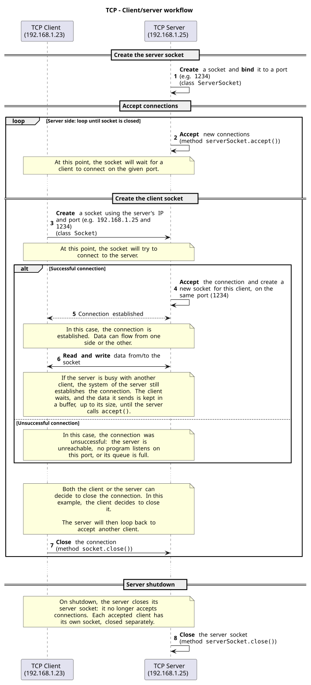
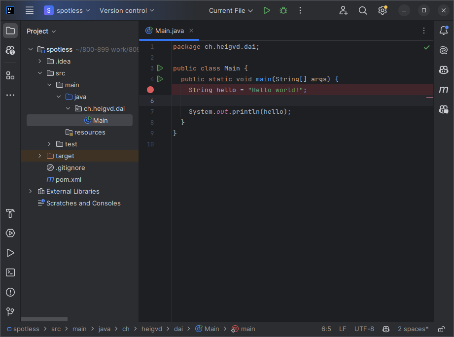
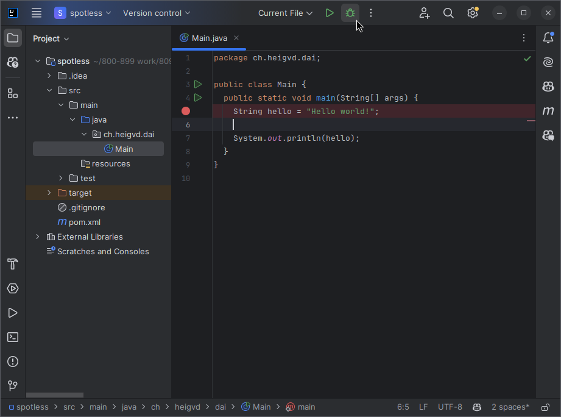
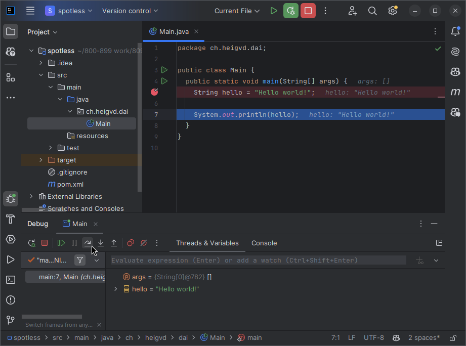
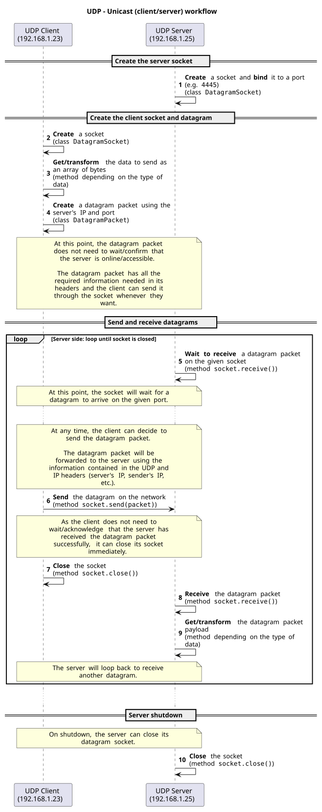
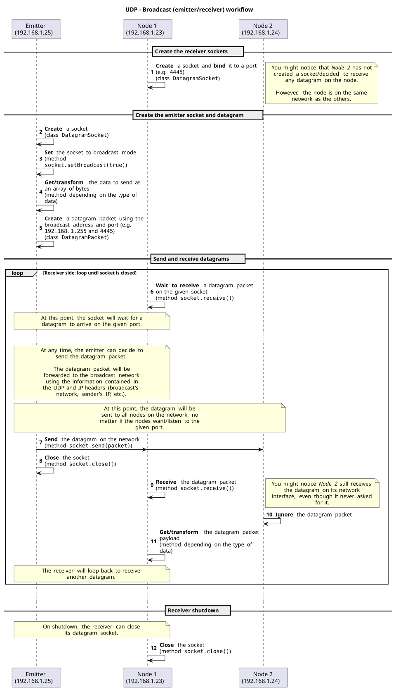
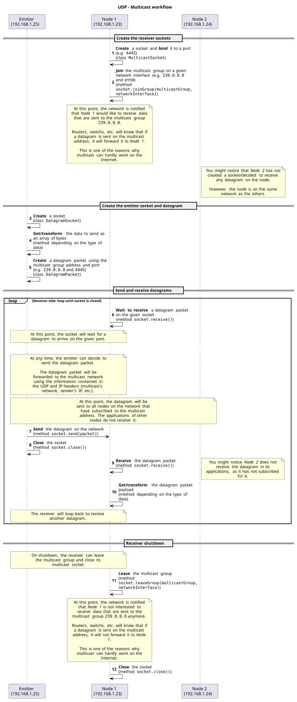
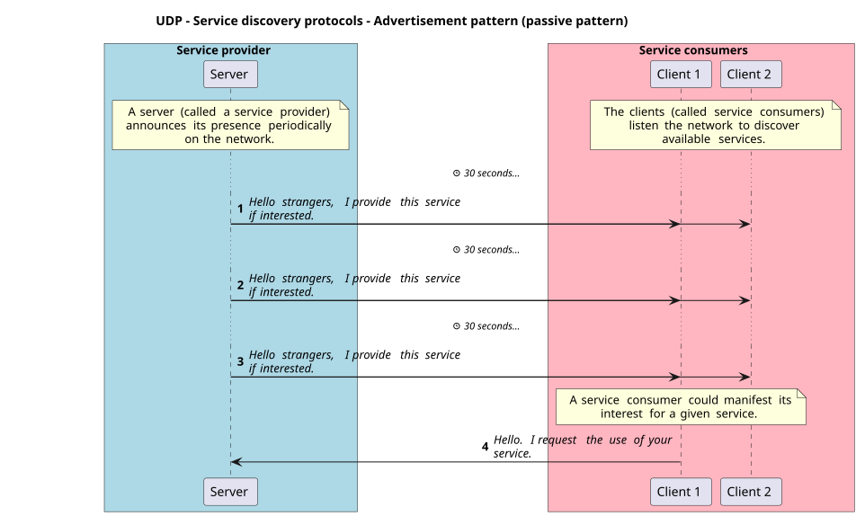
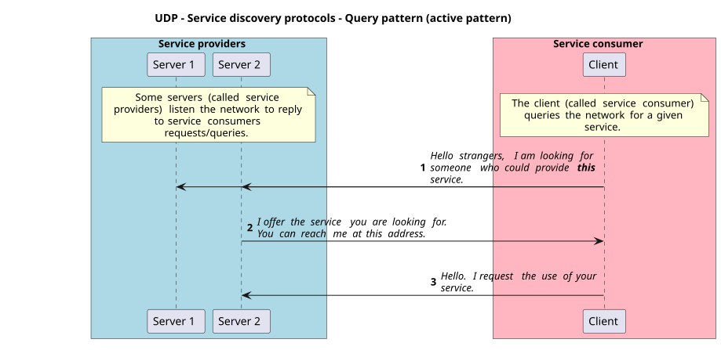

Slides: [part 1](../slides/08-tcp-udp-part-1.qmd) ·
[part 2](../slides/08-tcp-udp-part-2.qmd)

## Objectives

As you have seen in previous chapters, applications communicate with each other
using application protocols. In this chapter, you learn how to implement such
communication by programming your own TCP and UDP clients and servers (or
emitters and receivers) in Java. This allows you to create your own network
applications, such as a chat server, a file server, a web server or a real-time
multiplayer game server.

By the end of this chapter, you should be able to:

- Program your own TCP client/server applications in Java with the Socket API.
- Process data from TCP streams.
- Program your own UDP emitter/receiver applications in Java with the Socket
  API.
- Process data from UDP datagrams.
- Use the different ways to send a UDP datagram to one or multiple receivers.
- Explain how UDP can be used for service discovery.
- Make use of a REPL.

# Part 1/2

In this first part, you learn the basics of TCP programming in Java.

## Explore the code examples

Individually, or in pair/group, **take 15 minutes to explore and discuss the
code examples (part 1/2)** in the
[code examples repository](/tree/main/08-tcp-and-udp),
directory `08-tcp-and-udp`. Clone the repository or pull the latest changes
first.

Try to answer the following questions:

- How do the code examples work?
- What are the main takeaways of the code examples?
- What are the main differences between the code examples?

You can use the following content to help you.

## The Socket API

The Socket API lets programs create TCP and UDP network applications. In Java,
it is described in the
[`java.net` package](https://docs.oracle.com/en/java/javase/25/docs/api/java.base/java/net/package-summary.html)
of the
[`java.base` module](https://docs.oracle.com/en/java/javase/25/docs/api/java.base/module-summary.html).

It was originally developed in C for the Unix operating system by Berkeley
University. It has been ported to Java, and is now available on many platforms
and languages.

## TCP

TCP is a transport protocol: it transfers data between two applications.

TCP is **connection-oriented**: a connection must be established between the two
applications before data can be exchanged, in both directions.

TCP can only do **unicast**: a connection links exactly two applications. To
communicate with several servers, a client must establish a separate TCP
connection with each server.

TCP is considered **reliable**: if data is lost (for example due to network
issues), it is retransmitted. The application receives the data in order, or
gets an error once TCP detects that the connection is broken.

A good analogy is a phone call: you must first establish a connection with the
other person before you can talk to them. Once the connection is established,
they hear everything you say. If they did not hear you well, you can repeat what
you said until they hear you. They can, of course, also talk to you.

TCP is **stream-oriented**: data is sent as a stream of bytes. TCP splits this
stream into segments, and identifies each segment with a sequence number. Each
segment travels as the payload of an IP packet.

Thanks to the sequence numbers, TCP reassembles the segments in the correct
order. If a segment is lost, TCP retransmits it.

### TCP in the Socket API

To make it simple, a TCP socket is just like a file that you can open, read
from, write to and close. To exchange data, TCP sockets on both sides must be
connected. The stream classes are the same as with files, seen in
[chapter 04](04-java-io.qmd).

A TCP socket uses an IP address and a port number. It can act as a client or as
a server:

- A TCP socket accepting connections is called a server socket (class
  [`ServerSocket`](https://docs.oracle.com/en/java/javase/25/docs/api/java.base/java/net/ServerSocket.html)).
- A TCP socket initiating a connection is called a client socket (class
  [`Socket`](https://docs.oracle.com/en/java/javase/25/docs/api/java.base/java/net/Socket.html)).

The following schema shows the workflow of a TCP client/server application:

{fig-alt="Sequence diagram of a TCP client and server: create the server socket, accept, connect, read and write, close." width="80%"}

::: {.callout-note title="Note on socket connection behavior"}
As soon as the `ServerSocket` is created with a port, it starts listening for incoming
connection requests.

When a client creates a `new Socket(HOST, PORT);`, it attempts to establish a
TCP connection with the server. It is a blocking call.

By default, the operating system on the server side accepts the incoming TCP
connection request and puts it in a queue. From the client's perspective, the
connection is accepted and the socket is created, even though the server may not
yet have called `ServerSocket.accept()`. At this point, the client is on hold:
the data it sends, up to the size of the buffers, is kept by the server's
operating system.

When the server eventually calls `accept()`, a new `Socket` is created on the
server side, bound to the first pending connection of the queue, and the server
application receives any buffered data. The server and client can now communicate
with each other.

This explains why a client can connect to a server that is busy with another
client. The number of pending connections is limited. It can be configured with
the `backlog` parameter of the `ServerSocket`, and its behaviour depends on the
platform (the
[Javadoc](<https://docs.oracle.com/en/java/javase/25/docs/api/java.base/java/net/ServerSocket.html#%3Cinit%3E(int,int)>)
says the operating system can ignore it).

The Network concurrency chapter shows how to handle several clients on the
server side.
:::

### Processing data from streams

Sockets use data streams to send and receive data, just like files. You get an
input stream to read data from a socket, and an output stream to write data to a
socket:

```java
// Get input stream
input = socket.getInputStream();

// Get output stream
output = socket.getOutputStream();
```

You can then decorate these streams with other streams to process the data, just
as in [chapter 04](04-java-io.qmd):

```java
// Get input stream as text
input = new InputStreamReader(socket.getInputStream(), StandardCharsets.UTF_8);

// Get output stream as text
output = new OutputStreamWriter(socket.getOutputStream(), StandardCharsets.UTF_8);
```

Use buffered streams to improve performance:

```java
// Get input stream as binary with buffer
input = new BufferedInputStream(socket.getInputStream());

// Get output stream as binary with buffer
output = new BufferedOutputStream(socket.getOutputStream());
```

For text, the same applies with `BufferedReader` and `BufferedWriter`.

::: {.callout-important}
Do not forget to flush the output stream after writing data to it. Otherwise, the
remaining data in the buffer is not sent to the other application until the
buffer is full or the stream is closed!

```java
out.flush();
```

Also, do not forget all the good practices of [chapter 04](04-java-io.qmd)
(encoding, buffering, etc.). They must be applied here too!
:::

## Exercises (part 1)

### Exercise 1: Learn to use the debugger {#sec-ex1}

Every decent IDE has a debugger, a tool to inspect the state of your program at
runtime. It allows you to:

- Set breakpoints: a breakpoint is a point in your code where the program stops
  when it is reached.
- Step through your code, line by line, to see what is happening.
- Inspect the value of variables and expressions at runtime.

In IntelliJ IDEA, set a breakpoint by clicking on the left side of the line number:

{fig-alt="A breakpoint set in the left margin of the IntelliJ IDEA editor."}

Then, run the program in debug mode by clicking on the bug icon:

{fig-alt="The bug icon in the IntelliJ IDEA toolbar."}

The program stops at the breakpoint. You can then step through the code and inspect
variables and expressions:

{fig-alt="The debugger of IntelliJ IDEA, stopped on a line, with the value of the variables."}

Take some time to learn how to use the debugger in your favorite IDE. It is a very
useful tool.

### Exercise 2: Execute the code examples {#sec-ex2}

Return to the code examples (part 1/2). Each program is a single Java file: run it
from its directory with `java <ExampleName>.java`, the server first, in its own
terminal. Take some time to execute them, understand them and see the results. Use
the debugger to step through the code and see what is happening.

### Exercise 3: Explore the TCP template {#sec-ex3}

The directory `templates/java-tcp-programming` of the code examples is a simple
template to create your own TCP clients and servers in Java, as a Maven project
with picocli. Take some time to explore it, then try to answer these questions:

- How would you use it to create your own TCP clients and servers?
- What are the main takeaways of the template?
- How would you implement a TCP network application using the template and the code
  examples?

### Exercise 4: Repair a broken client and server with ncat {#sec-ex4}

`ncat` ([chapter 07](07-smtp-and-ncat.qmd#ncat)) can replace either side of a
textual protocol, and shows exactly what the other side sends:

```sh
# Replace the client: type the lines yourself
ncat localhost 6430

# Replace the server: see what the client sends, and type the answers
ncat -l 6430
```

`exercises/BrokenEchoClient.java` and `exercises/BrokenEchoServer.java` should send
lines and echo them back. They compile, start, and hang.

1. Run the broken client against `ncat -l 6430`. What does ncat show? Type an answer
   in ncat, three times. What does ncat show when the client ends?
2. Run `ncat localhost 6430` against the broken server. Type lines, then press
   `Ctrl` + `D`. What does the server print, and what comes back?
3. Find the two errors on each side, and fix them.

::: {.callout-tip collapse="true" title="Solution"}
1. Nothing while the client runs: its line stays in the buffer of the
   `BufferedWriter`. When the client closes its streams, the buffer is flushed, and
   ncat shows `Hello 1Hello 2Hello 3`, on one line.
2. The server prints `Received: ...` for each line. Nothing comes back until
   `Ctrl` + `D`: the server then closes its streams, which flushes the buffer, and
   ncat shows your lines, glued together.
3. On both sides, `out.write(line)` must become `out.write(line + "\n")` followed by
   `out.flush()`. `readLine()` removes the end of line, and waits for one on the
   other side; the `flush()` makes the bytes leave.
:::

# Part 2/2

In this second part, you learn UDP programming in Java, and some of its unique
features compared to TCP.

## Explore the code examples

Individually, or in pair/group, **take 15 minutes to explore and discuss the code
examples (part 2/2)**, in the same directory, and try to answer the same questions
as in part 1.

## UDP

UDP is a transport layer protocol, just like TCP. There are numerous differences
between them.

UDP is **connectionless**: it does not require a connection to be established
before sending data.

UDP does not provide any reliability mechanism: it does not guarantee that the
data is received at all, nor that it is received in the order it was sent.

A good analogy is the postal service with postcards: you write several postcards
and send them to someone. You do not know if they will be received, nor if they
will arrive in the same order as they were sent.

Just as with postcards, UDP alone is used when reliability is not required.

### UDP datagrams

UDP is a datagram protocol: it sends data in discrete chunks called
*"datagrams"*.

Datagrams are like the postcards of the analogy: they are sent independently from
each other. They contain a destination address, a payload and the sender address.
If you need to, you can use the sender address to reply to the sender.

A datagram is composed of a header and a payload. The header contains information
about the datagram, such as the source and destination ports. The payload contains
the data to send. It can be a notification, a request, a query, a response, etc.
It is up to the application to define its format.

An IPv4 packet holds at most 65,535 bytes, as its length is encoded on 16 bits.
Without the headers of IPv4 (20 bytes) and UDP (8 bytes), the payload of a datagram
is limited to 65,507 bytes.

If a datagram is too large for the network to carry in one packet, IP splits it
into fragments and reassembles them on arrival. IP delivers the whole datagram or
nothing: if one fragment is lost, the whole datagram is lost. A receive buffer that
is too small silently cuts the datagram.

### Reliability

As UDP does not provide any reliability mechanism, it is up to the application to
implement it. For example, the application can acknowledge the reception of a
datagram, and ask for retransmission if some data was not received. What TCP offers
by default has to be implemented by the application with UDP.

In certain cases, reliability is not required: some applications tolerate data
loss. Streaming is a perfect use case. If a datagram is lost, the receiver receives
the next one and the stream continues. Take the streaming of a live event on your
television:

- If a few datagrams are lost, you might notice a few glitches (video artifacts),
  but they do not affect the entire stream.
- If too many datagrams are lost, the receiver cannot rebuild the images and the
  stream stops.

Some video services such as [Jitsi](https://jitsi.org/) (an open source
Zoom/Google Meet/Teams alternative) can use UDP with the help of
[WebRTC](https://webrtc.org/). Even these applications might prefer TCP to
guarantee the reliability of their services.

The game [Factorio](https://www.factorio.com/) (a video game where you build and
manage factories) is another good example of an application that uses UDP when
playing on a multiplayer server:

> Factorio uses UDP only. The game builds its own "reliable delivery" layer built
> on UDP to deal with packet loss and reordering issues.
>
> <https://wiki.factorio.com/Multiplayer>

We can illustrate reliability with the following example. You have developed a very
simple application protocol where clients send `INCREMENT` and `DECREMENT` commands
to increment or decrement a counter on the server. The counter is shared between
all clients.

If the clients send 10 `INCREMENT` commands, the counter should be incremented by
10. But one of the datagrams could be lost: if the server receives 9 `INCREMENT`
commands, the counter is incremented by 9.

Both parties could implement a reliability mechanism to solve this issue: the
server acknowledges the reception of a datagram, and a client that does not receive
an acknowledgement *within a specific period* retransmits the datagram.

However, even the acknowledgement could be lost. The client could retransmit the
datagram several times, and the server could receive it several times. The server
could then detect duplicate datagrams and ignore them, and also detect out-of-order
datagrams and reorder them, with a message ID for example, just as TCP does.

Handling reliability is quite challenging. **In this course, reliability is not
required. We can assume the network never fails.** We focus on the UDP protocol
itself, and not on reliability mechanisms.

If you are interested, have a look at the
[Automatic Repeat reQuest (ARQ)](https://en.wikipedia.org/wiki/Automatic_repeat_request)
protocol, a mechanism used to detect and retransmit lost datagrams, and at
[*Timeouts* in *Go further*](#go-further).

### UDP in the Socket API

In the UDP world, the
[`DatagramSocket`](https://docs.oracle.com/en/java/javase/25/docs/api/java.base/java/net/DatagramSocket.html)
class replaces the `Socket` class. It is used to create UDP clients and servers,
and to send and receive UDP datagrams.

A datagram is created with the
[`DatagramPacket`](https://docs.oracle.com/en/java/javase/25/docs/api/java.base/java/net/DatagramPacket.html)
class, with a payload and a destination address.

A multicast socket is created with the
[`MulticastSocket`](https://docs.oracle.com/en/java/javase/25/docs/api/java.base/java/net/MulticastSocket.html)
class. It joins a multicast group to receive the datagrams sent to that group,
just like a message sent to a group of people.

UDP can be used to create a client/server architecture, or a peer-to-peer one.

The following schema shows the workflow of a UDP unicast (client/server)
application:

{fig-alt="Sequence diagram of a UDP client and server: create the sockets, create a datagram, send and receive it, close." width="80%"}

### Processing data from datagrams

A datagram contains a payload, as a byte array. You can convert it to a string or
any other data type.

You can create a datagram with a byte array as payload:

```java
// Create a datagram with a payload and a destination address
byte[] buffer = "Hello, World!".getBytes(StandardCharsets.UTF_8);
DatagramPacket packet = new DatagramPacket(buffer, buffer.length, InetAddress.getByName("localhost"), 1234);
```

You can get the payload of a received datagram as a byte array:

```java
// Create a datagram to receive data
byte[] buffer = new byte[1024];
DatagramPacket packet = new DatagramPacket(buffer, buffer.length);

// Receive a datagram
socket.receive(packet);

// Get the payload of the datagram
byte[] data = packet.getData();
int length = packet.getLength();
String message = new String(data, 0, length, StandardCharsets.UTF_8);
```

## Unicast, broadcast and multicast

UDP supports three types of communication: unicast, broadcast and multicast. TCP
only supports unicast.

### Unicast

Unicast is the most common type of communication. It is a one-to-one communication:
a datagram is sent from one host to another host, just like TCP.

{fig-alt="One sender reaching one receiver among several nodes." width="35%"}

Think of it as a private conversation between two people.

To send a unicast datagram, the sender must know the IP address and port of the
receiver. It is mostly the same as TCP, without all the reliability features
provided by TCP but with all the performance of UDP.

### Broadcast

Broadcast is a one-to-all communication: a datagram is sent from one host to all
hosts on the network.

{fig-alt="One sender reaching all the nodes." width="35%"}

Think of it as a public announcement.

To send a broadcast datagram, the sender must know the broadcast address, a special
address that represents all hosts of a specific subnet.

The broadcast address is defined by the network address and the subnet mask, a
32-bit number. It is written
as four numbers separated by dots (`255.255.255.0`), or as a single number (`/24`
for `255.255.255.0`, as 24 bits are set to `1`).

A good example is the following table (source:
[Wikipedia](https://en.wikipedia.org/wiki/Broadcast_address)):

::: {style="font-size: 0.85em"}
| Network IP address breakdown for `172.16.0.0/12` | Binary form | Dot-decimal notation |
|---|---|---|
| 1. Network IP address | 10101100.0001**0000.00000000.00000000** | `172.16.0.0` |
| 2. Subnet mask: `/12` means the 12 left-most bits are `1`s. They are the network address (prefix); the `32 - 12 = 20` others are the host address (suffix) | 11111111.1111**0000.00000000.00000000** | `255.240.0.0` |
| 3. Bit complement (bitwise NOT) of the subnet mask | 00000000.0000**1111.11111111.11111111** | `0.15.255.255` |
| 4. Broadcast address: bitwise OR of the network IP address and the bit complement of the subnet mask, the largest address of the network | 10101100.0001**1111.11111111.11111111** | `172.31.255.255` |
:::

To send a broadcast to all the devices of the local network, whatever their subnet,
you can use the `255.255.255.255` broadcast address.

::: {.callout-important}
There can be restrictions on the use of broadcast. Broadcast is limited to the local
network, and can still be blocked by a firewall and/or a router.
:::

In C and in Python, a socket needs the `SO_BROADCAST` option to send a broadcast.
Java's `DatagramSocket` has it on by default, and the code examples still call
`socket.setBroadcast(true)` to state the intent.

{fig-alt="Sequence diagram of a broadcast: every node receives the datagram, and a node without a socket on that port ignores it." width="80%"}

### Multicast

Multicast is a one-to-many communication: a datagram is sent from one host to
multiple hosts.

{fig-alt="One sender reaching a group of nodes." width="35%"}

Think of it as a group conversation.

To send a multicast datagram, the sender uses a multicast address, a special address
that represents a group of hosts on the network. Think of it as a radio channel or a
Discord channel: everyone on the channel receives the messages sent on it.

Multicast addresses are specific IP addresses in the range from `224.0.0.0` to
`239.255.255.255` for IPv4, and `ff00::/8` for IPv6.

Just as for ports, some multicast addresses are reserved for specific purposes. A
complete list is available on the
[IANA website](https://www.iana.org/assignments/multicast-addresses/multicast-addresses.xhtml),
further described in
[RFC 5771](https://datatracker.ietf.org/doc/html/rfc5771).

For local networks, the range comes from the **Administratively Scoped Block** of
that RFC, with more details in
[RFC 2365](https://datatracker.ietf.org/doc/html/rfc2365). Addresses in
the range `239.0.0.0` to `239.255.255.255` can be used for your own applications.

Just as for broadcast, the sender must know the multicast address, and there can be
restrictions on the use of multicast.

{fig-alt="Sequence diagram of a multicast: only the applications of the node that joined the group receive the datagram." width="80%"}

Multicast is almost guaranteed **not** to work on the public Internet, which greatly
limits its usage. To use multicast across the Internet, you need a tunnel such as a
virtual private network (VPN).

Multicast is presented in this course because it is an important concept in service
discovery protocols. In this course, if you decide to use multicast, we assume you
use it on a (reliable) local network.

Multicast is a complex topic, not covered in depth here. For a deeper understanding,
you can read the following resources:

- [IP multicast](https://en.wikipedia.org/wiki/IP_multicast)
- [Internet Group Management Protocol](https://en.wikipedia.org/wiki/Internet_Group_Management_Protocol)
- [Internet Protocol television](https://en.wikipedia.org/wiki/Internet_Protocol_television)

## Messaging patterns

As UDP does not provide a connection mechanism, it is up to the application to define
the messaging pattern (how to send and receive data). There are two common messaging
patterns.

The **fire-and-forget** pattern is the simplest one. It is a one-way communication: a
datagram is sent from one host to one or several hosts without expecting a response. It is
used when the sender does not need to know if the datagram was received or not.

The **request-response** (sometimes called request-reply) pattern is a two-way
communication: a datagram is sent from one host to another host, and a response is
expected.

Every datagram carries the port of the socket that sent it: the port you bound the
socket to, or a port the operating system chose. The receiver extracts the sender's
IP address and port, and uses them to reply in unicast.

The request-response pattern can be used when the sender needs to know that the
datagram was received. Both sides of the communication can send a request and receive a
response.

## Service discovery protocols

With unicast, the sender must know the IP address of the receiver.

With broadcast and multicast, the sender does not need to know who the receivers are:
it knows that nodes nearby (or those who expressed interest) can receive the datagram.

Using this property, it is possible to create service discovery protocols. They are
used to find services on the network without knowing their IP address.

There are two types of service discovery protocols: passive and active. Passive
protocols are based on broadcast or multicast, and announce the presence of a service
on the network. Active protocols also start with broadcast or multicast, then switch
to unicast: they query the network to find a service.

The most common patterns are the following:

- **Advertisement**, a passive pattern: a server (called a service provider) announces
  its presence on the network, with a broadcast or multicast datagram. The datagram
  contains information about the service (name, IP address, port, etc.), and is sent
  periodically to announce that the service is still available.

  The clients (called service consumers) listen to these datagrams to discover the
  services on the network. A service consumer interested by a service provider can
  then manifest its interest.

  {fig-alt="A server announces its service to two clients every 30 seconds; one client then requests the service." width="80%"}

- **Query**, an active pattern: a client (called a service consumer) sends a multicast
  or broadcast datagram on the network to request information about a service.

  If a server that provides the service (called a service provider) is available, it
  replies with a unicast datagram containing the information to connect to the
  service, as in the request-response pattern.

  {fig-alt="A client queries two servers; one answers with its address, and the client requests the service." width="80%"}

Once the service is found, the rest of the exchange can use another protocol, such as
TCP.

## Read-eval-print loop (REPL)

To run several commands on a server without closing the connection, you can use a
[read-eval-print loop (REPL)](https://en.wikipedia.org/wiki/Read%E2%80%93eval%E2%80%93print_loop).

To make it simple, a REPL is a loop that asks the user to input commands, executes
each command and displays the result, until the user decides to exit the loop.

In the context of a server, the server waits for the client to send a command,
executes it, sends the result back, and waits for a new command without closing the
connection. The client sends commands until the user decides to close the connection.

Both the client and the server can close the connection at any time. It is up to the
developer to decide when and who closes it.

## Summary of differences between TCP and UDP

| TCP | UDP |
|---|---|
| Connection-oriented | Connectionless |
| Reliable | Unreliable |
| Stream protocol | Datagram protocol |
| Unicast | Unicast, broadcast and multicast |
| Defined by the application (often request-response) | Fire-and-forget, request-response (manual) |
| - | Service discovery protocols |
| Used mainly for FTP, HTTP, SMTP, SSH, etc. | Used mainly for DNS, streaming, gaming, etc. |

## Exercises (part 2)

### Exercise 5: Execute the code examples {#sec-ex5}

Return to the code examples (part 2/2). Take some time to execute them, understand
them and see the results. Use the debugger to step through the code and see what is
happening. Most examples' READMEs ask what you notice.

### Exercise 6: Explore the UDP template {#sec-ex6}

The directory `templates/java-udp-programming` of the code examples is a simple
template to create your own UDP emitters/clients and receivers/servers in Java, as a
Maven project with picocli. Take some time to explore it, then try to answer these
questions:

- How would you use it to create your own UDP emitters/clients and
  receivers/servers?
- What are the main takeaways of the template?
- How would you implement a UDP network application using the template and the code
  examples?

### Exercise 7: Update your application protocols {#sec-ex7}

Now that you have gained new knowledge regarding TCP and UDP, update the application
protocols you created for the *"Guess the number"* game and the *"Temperature
monitoring"* application in [chapter 06](06-application-protocols.qmd).

You can compare them with the
[*"Guess the number"*](/tree/main/06-application-protocols/guess-the-number)
and
[*"Temperature monitoring"*](/tree/main/06-application-protocols/temperature-monitoring)
specifications.

### Exercise 8: Access the TCP server from several TCP clients at the same time {#sec-ex8}

Start the server of the example `08-tcp-repl-client-server`, then its client several
times, at the same time. You will see that the server can only handle one client at a
time.

Do you have any idea why? Discuss with your peers if needed to share your findings.

::: {.callout-tip collapse="true" title="Solution"}
The server stays in its loop on one client until that client leaves, and only then
calls `accept()` again. The second client connects (the operating system queues the
connection), then waits for its answer. Chapter 09 shows how to serve several clients
at the same time.
:::

### Exercise 9: Emit from several UDP emitters at the same time {#sec-ex9}

Start the receiver of the example `07-udp-fire-and-forget-messaging-pattern`, then its
emitter several times, at the same time. You will see that the receiver gets all the
messages of the emitters.

Do you have any idea why? How does it compare to the TCP example you have just seen?

::: {.callout-tip collapse="true" title="Solution"}
UDP has no connection. The receiver has a single socket, and each datagram that
arrives on it is independent, whoever sent it. The TCP server has one socket per client,
and reads only the one it is serving.
:::

## Go further

Optional content: useful general knowledge, not required for the evaluations.

### Implement the *"Guess the number"* game

Implement the *"Guess the number"* game with the application protocol you made in
[chapter 06](06-application-protocols.qmd), or the
[specification](/tree/main/06-application-protocols/guess-the-number)
of the code examples. Use the template and the code examples to help you: copy
`templates/java-tcp-programming` to your own repository.

**Dockerize the application.** Using [chapter 05](05-docker.qmd), create a `Dockerfile`
for the application, and publish it to GitHub Container Registry. You should then be
able to run the server and the client in Docker containers, on a network of your own:

```sh
# Create the network, once
docker network create dai

# Start the server
docker run --rm -it --network dai --name the-server <docker-image-tag> server

# Start the client and access the server container
docker run --rm -it --network dai <docker-image-tag> client --host the-server
```

On such a network, Docker resolves the `--name` of a container, so the client reaches
the server by that name. No ports are published to the host, as both containers
communicate over the network without passing by the host.

**Compare your solution** with `solutions/guess-the-number` in the code examples, which
follows the specification of the code examples.

**Go one step further:**

- Can you update the application to allow the client to specify the range of the number
  to guess before starting the game?
- Can you implement the *"Temperature monitoring"* application with TCP?

### Implement the *"Temperature monitoring"* application

Implement the *"Temperature monitoring"* application with the application protocol you
made in [chapter 06](06-application-protocols.qmd), or the
[specification](/tree/main/06-application-protocols/temperature-monitoring)
of the code examples. Use the template and the code examples to help you: copy
`templates/java-udp-programming` to your own repository.

**Dockerize the application** in the same way. You should then be able to run the
emitter, the receiver and the operator in Docker containers:

```sh
# Start the emitter
docker run --rm -it --network dai <docker-image-tag> emitter --name Kitchen

# Start the receiver
docker run --rm -it --network dai --name the-receiver <docker-image-tag> receiver --network-interface eth0

# Start the operator and access the receiver container
docker run --rm -it --network dai <docker-image-tag> operator --host the-receiver
```

**Compare your solution** with `solutions/temperature-monitoring`, which has the
emitter and the receiver of the specification. The operator needs the receiver to read
two sockets at the same time: `Receiver` in the template already starts two threads,
and chapter 09 explains them.

**Go one step further:**

- Can you update the application protocol to allow the operator to get the latest
  temperature of a given room, or its average temperature? This requires storing all
  the temperatures received for a room.
- Can you implement the *"Guess the number"* game with UDP?

### More

::: {.callout-note collapse="true" title="Variable length data"}
Depending on the application protocol, the data sent can have a variable length. There
are two common ways to handle it: use a delimiter, or send the length first.

With a delimiter, use a buffered reader to read the data until the delimiter is found:

```java
// End of transmission character
String EOT = "\u0004";

// Read data until the delimiter is found
String line;
while ((line = in.readLine()) != null && !line.equals(EOT)) {
  System.out.println("[Server] received data from client: " + line);
}
```

Otherwise, send the length of the data before the data itself:

```java
// Send the length of the data
out.write("DATA_LENGTH " + data.length() + "\n");

// Send the data
out.write(data);
out.flush();
```

```java
// Read the length of the data
String[] parts = in.readLine().split(" ");
int dataLength = Integer.parseInt(parts[1]);

// Read the data
for (int i = 0; i < dataLength; i++) {
  System.out.print((char) in.read());
}
```
:::

::: {.callout-note collapse="true" title="Timeouts"}
In the example `06-udp-request-response-messaging-pattern`, start the client without
the server: `socket.receive()` blocks forever. `setSoTimeout()` limits the wait, and
lets the client give up or send its request again, as the *"Temperature monitoring"*
specification allows the operator to do:

```java
// receive() now waits at most 2 seconds, then throws a SocketTimeoutException
socket.setSoTimeout(2000);

try {
  socket.receive(responsePacket);
} catch (SocketTimeoutException e) {
  System.out.println("[Client] No response within 2 seconds");
}
```
:::

## Conclusion

You have learned how to use the Socket API to create your own TCP clients and servers
in Java, how to use UDP to build different kinds of network applications, and the
differences between TCP and UDP. You can now create your own network applications, such
as a file server or a web server, and containerize them to use them
anywhere.

For now, our TCP servers serve only one client at a time. Chapter 09
shows how to manage several clients at the same time.

## Test your knowledge

- What is a socket?
- What is the difference between a server socket and a client socket?
- How do sockets compare to files?
- Why is TCP considered a reliable protocol?
- What are the differences between UDP and TCP?
- Why is UDP unreliable? How to mitigate this?
- What is a datagram? How can a datagram be sent without a server listening?
- What are the differences between unicast, broadcast and multicast?
- What are the messaging patterns and their differences?
- What are the service discovery protocols? How do they compare to each other?

## Sources

- O. Tischhauser, with the help of
  [Claude](https://claude.com) (Anthropic).
- Based on the
  [HEIG-VD DAI course](https://github.com/heig-vd-dai-course/heig-vd-dai-course)
  by L. Delafontaine and H. Louis, licensed
  [CC BY-SA 4.0](https://creativecommons.org/licenses/by-sa/4.0/),
  itself based on the original course by O. Liechti and
  J. Ehrensberger.
- The broken client and server of exercise 4 come from the DAI course of
  J. Ehrensberger.
- Unicast, broadcast and multicast illustrations from
  [Wikimedia Commons](https://commons.wikimedia.org/).
