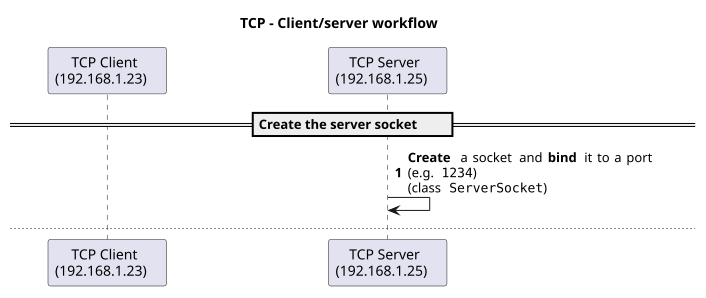
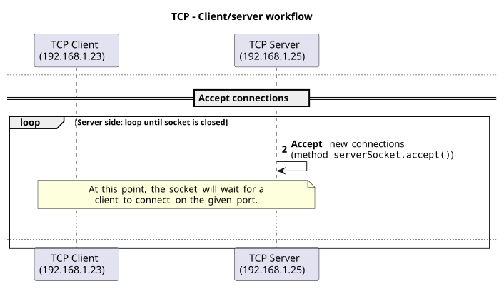
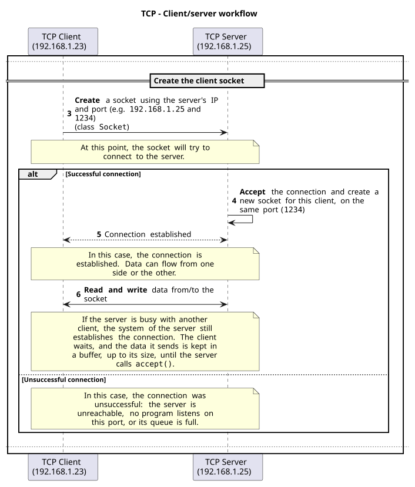
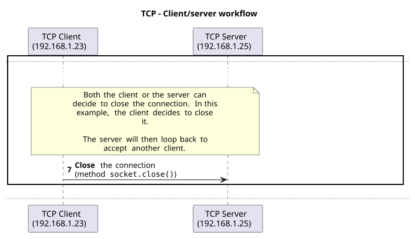
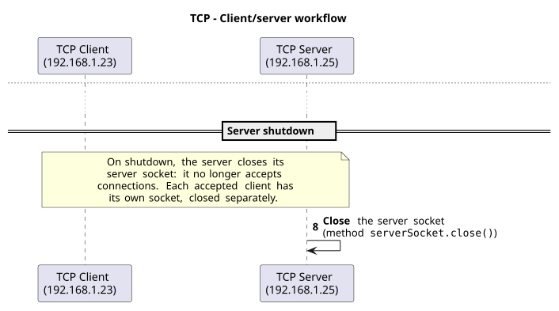

## Objectives

- Program your own TCP client/server applications in Java with the Socket API.
- Process data from TCP streams.

**Your applications will be able to communicate over the network!**

## Part 1/2

In this first part, you learn the basics of TCP programming in Java.

## The Socket API

- API to create TCP and UDP network applications.
- In Java: the
  [`java.net` package](https://docs.oracle.com/en/java/javase/25/docs/api/java.base/java/net/package-summary.html)
  of the
  [`java.base` module](https://docs.oracle.com/en/java/javase/25/docs/api/java.base/module-summary.html).
- Originally developed by Berkeley University for the Unix operating system.
- Ported to Java and many other languages.
- Provides classes and methods to create sockets, connect to remote hosts, send
  and receive data, etc.

## TCP

TCP is a transport protocol that is similar to a phone call:

1. A connection is established between two parties (unicast).
2. Data sent arrives in the same order.
3. Lost data is sent again (retransmission).

It is a **stream** protocol: TCP splits the bytes into numbered segments,
reorders them on arrival and retransmits the lost ones.

## TCP in the Socket API

::: {style="font-size: 0.85em"}
- Two classes to create TCP applications:
  - [`ServerSocket`](https://docs.oracle.com/en/java/javase/25/docs/api/java.base/java/net/ServerSocket.html)
    (server side).
  - [`Socket`](https://docs.oracle.com/en/java/javase/25/docs/api/java.base/java/net/Socket.html)
    (client side, and on the server for each accepted connection).
- A TCP socket is a connection endpoint between two parties, using a host and a
  port.
- A server socket listens for incoming connections on a specific port.
- A client socket connects to a server socket using the server's host and port.
- Once connected, data is exchanged between the client socket and the socket
  returned by `accept()`.
:::

## {.center}

{fig-alt="TCP workflow, step 1: create the server socket." .nostretch fig-align="center" width="85%"}

## In code: the server socket

```java
// Creates the socket, binds it to the port and starts listening
ServerSocket serverSocket = new ServerSocket(6430);
```

- From now on, clients can connect to this port.
- If another program already listens on the port: `Address already in use`.

## {.center}

{fig-alt="TCP workflow, step 2: accept new connections." .nostretch fig-align="center" height="620"}

## In code: accept()

```java
// Blocks until a client connects
Socket socket = serverSocket.accept();
```

- Returns a **new** `Socket` for this client, on the same port.
- The server reads and writes through this socket.
- `serverSocket` only accepts connections: call `accept()` again for the next
  client.

## {.center}

{fig-alt="TCP workflow: create the client socket, connection established or not." .nostretch fig-align="center" height="630"}

## In code: the client socket

```java
// Opens the connection to the server
Socket socket = new Socket("localhost", 6430);
```

- The client needs one socket: the system chooses its port.
- If no server listens on the port: `ConnectException: Connection refused`.
- Reading and writing use streams: see the next slides.

## {.center}

{fig-alt="TCP workflow: the client closes the connection, the server loops back." .nostretch fig-align="center" height="620"}

## In code: the client closes

```java
// The client
socket.close();
```

```java
// The server: readLine() returns null once the client has closed
while ((line = in.readLine()) != null) {
  // ...
}
socket.close();
// Back to accept() for the next client
```

## {.center}

{fig-alt="TCP workflow: the server closes its server socket." .nostretch fig-align="center" height="620"}

## In code: the server closes

```java
serverSocket.close();
```

- New clients are refused: `ConnectException: Connection refused`.
- The sockets already accepted stay open: your code must close each one.

## Processing data from streams

Sockets use data streams to send and receive data, just like files:

- Get an input stream to read data from a socket.
- Get an output stream to write data to a socket.

```java
// Get input stream
input = socket.getInputStream();

// Get output stream
output = socket.getOutputStream();
```

## As text

Read and write data from/to the streams as text:

```java
// Get input stream as text
input = new InputStreamReader(
    socket.getInputStream(), StandardCharsets.UTF_8);

// Get output stream as text
output = new OutputStreamWriter(
    socket.getOutputStream(), StandardCharsets.UTF_8);
```

## With a buffer

Improve performance with a buffer (here, with a binary stream):

```java
// Get input stream as binary with buffer
input = new BufferedInputStream(socket.getInputStream());

// Get output stream as binary with buffer
output = new BufferedOutputStream(socket.getOutputStream());
```

**Everything you have learned about Java IOs applies here!** Do not forget to
`flush()`.

## Example: the echo server

::: {style="font-size: 0.66em"}
```java
import java.io.*;
import java.net.*;
import java.nio.charset.StandardCharsets;

public class EchoServer {
  public static void main(String[] args) throws IOException {
    try (ServerSocket serverSocket = new ServerSocket(6430)) {
      while (true) {
        try (Socket socket = serverSocket.accept();
            BufferedReader in = new BufferedReader(new InputStreamReader(
                socket.getInputStream(), StandardCharsets.UTF_8));
            BufferedWriter out = new BufferedWriter(new OutputStreamWriter(
                socket.getOutputStream(), StandardCharsets.UTF_8))) {
          String line;
          while ((line = in.readLine()) != null) {
            out.write(line + "\n");
            out.flush();
          }
        } catch (IOException e) {
          System.out.println("Error with this client: " + e.getMessage());
        }
      }
    }
  }
}
```
:::

## Example: the echo client

::: {style="font-size: 0.8em"}
```java
import java.io.*;
import java.net.*;
import java.nio.charset.StandardCharsets;

public class EchoClient {
  public static void main(String[] args) throws IOException {
    try (Socket socket = new Socket("localhost", 6430);
        BufferedReader in = new BufferedReader(new InputStreamReader(
            socket.getInputStream(), StandardCharsets.UTF_8));
        BufferedWriter out = new BufferedWriter(new OutputStreamWriter(
            socket.getOutputStream(), StandardCharsets.UTF_8))) {
      for (int i = 1; i <= 3; i++) {
        out.write("Hello " + i + "\n");
        out.flush();
        System.out.println("Received: " + in.readLine());
      }
    }
  }
}
```
:::

```{.text .fragment}
Received: Hello 1
Received: Hello 2
Received: Hello 3
```

## Connecting to a busy server

- As soon as the `ServerSocket` is created with a port, it listens.
- The system accepts connections by itself, and **queues** them until the
  program calls `accept()`. Data sent meanwhile is kept, up to the size of the
  buffers.
- So a second client can connect while the server is busy with the first one. It
  waits until the server calls `accept()` again.
- The queue is limited: the `backlog` parameter of `ServerSocket`.
- Handling several clients: chapter 09.

## Explore the code examples

Alone, in pairs or in groups, **take 15 minutes to explore and discuss the
[code examples (part 1/2)](https://github.com/heigvd-dai-26/dai-code-examples/tree/main/08-tcp-and-udp)**.

Answer the questions of the chapter:

- How do the code examples work?
- What are the main takeaways of the code examples?
- What are the main differences between the code examples?

If needed, use the theoretical content to help you.

## End of part 1/2

Do you have any questions?

## What will you do?

- Learn to use the debugger.
- TCP: execute the code examples.
- Explore the Java TCP programming template.
- Repair a broken client and server with ncat.

**Do not hesitate to help each other! There's no need to rush!**

## Credits

::: {style="font-size: 0.7em"}
- O. Tischhauser, with the help of
  [Claude](https://claude.com) (Anthropic).
- Based on the
  [HEIG-VD DAI course](https://github.com/heig-vd-dai-course/heig-vd-dai-course)
  by L. Delafontaine and H. Louis, licensed
  [CC BY-SA 4.0](https://creativecommons.org/licenses/by-sa/4.0/), as is
  this deck, itself based on the original course by O. Liechti and
  J. Ehrensberger.
:::
