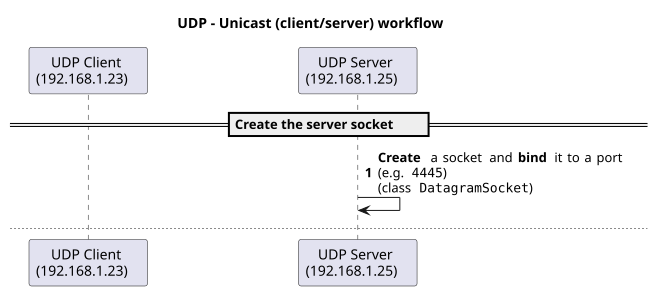
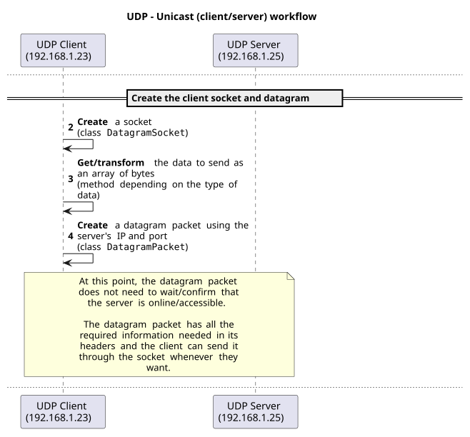
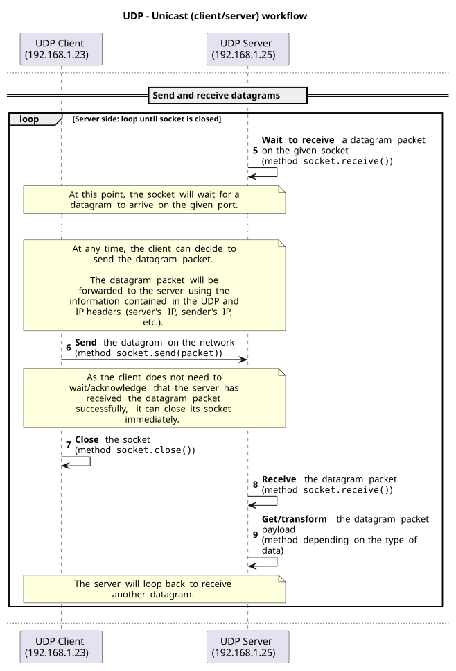
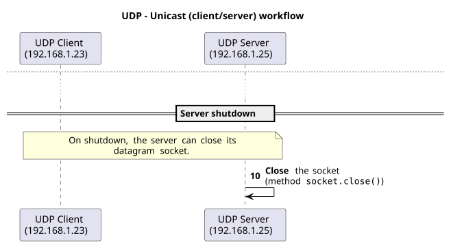
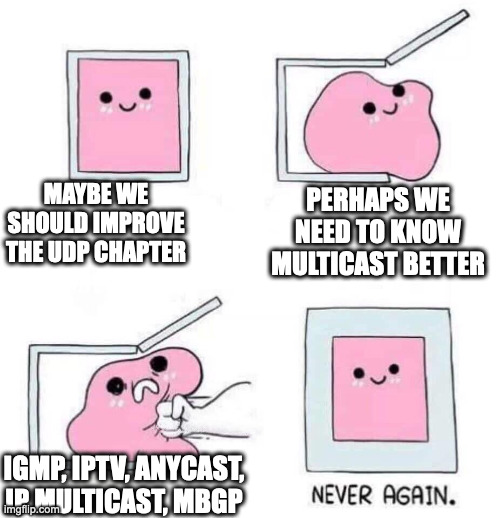
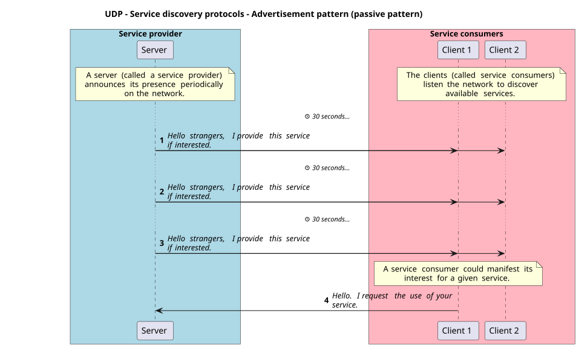
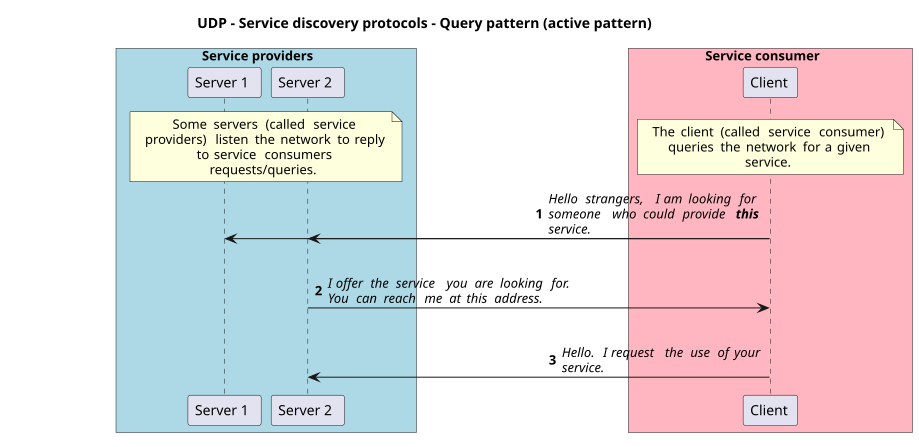

## Objectives

- Program your own UDP emitter/receiver applications in Java with the Socket
  API.
- Process data from UDP datagrams.
- Use the different ways to send a UDP datagram to one or multiple receivers.
- Explain how UDP can be used for service discovery.
- Make use of a REPL.

## Part 2/2

In this second part, you learn UDP programming in Java, and some of its unique
features compared to TCP.

## UDP

- A transport layer protocol just like TCP.
- Connectionless protocol: does not require a connection before sending data.
- Unreliable protocol: does not guarantee delivery but is fast.
- Analogy: sending postcards through the postal service.

## UDP datagrams

- Datagrams are discrete chunks of data (packets) sent over the network.
- Sent individually and independently, just as postcards.
- Each datagram is self-contained and has all the information needed for routing
  and delivery, thanks to its headers.
- The UDP header contains the source and destination ports, the length and the
  checksum, followed by a payload (data).
- Maximum size of a UDP datagram: 65,535 bytes, headers included. Over IPv4, the
  payload holds at most 65,507 bytes.

## Reliability

- UDP is unreliable (no guarantee of delivery, no guarantee of order).
- The application must implement its own reliability mechanism.
- In some cases, reliability is not needed (e.g. streaming).
- Example: `INCREMENT` lost, the counter is wrong. Acknowledge, retransmit, detect
  duplicates: it gets complex.
- Handling reliability is complex: **not required in this course.**

## UDP in the Socket API

- `DatagramSocket` is used to send and receive datagrams.
- A datagram is created with the `DatagramPacket` class.
- A datagram socket can send and receive datagrams to/from any host and port.
- A datagram socket can be bound to a specific port to listen for incoming
  datagrams.
- A datagram socket can be used to send and receive datagrams without
  establishing a connection.

## {.center}

{fig-alt="UDP workflow: create the server socket." .nostretch fig-align="center" width="85%"}

## {.center}

{fig-alt="UDP workflow: create the client socket and the datagram." .nostretch fig-align="center" height="620"}

## In code: the sockets

```java
// The server: bound to a port, it receives what is sent to this port
DatagramSocket socket = new DatagramSocket(4445);
```

```java
// The client: the system chooses a free port
DatagramSocket socket = new DatagramSocket();
```

- There is no connection to open and no `accept()`.
- Each datagram carries its own destination.

## {.center}

{fig-alt="UDP workflow: send and receive datagrams." .nostretch fig-align="center" height="630"}

## In code: send and receive

```java
// The client: the packet holds the payload and the destination
socket.send(packet);
```

```java
// The server: blocks until a datagram arrives, then fills the packet
socket.receive(packet);
```

- `send()` returns at once, even if no one is listening.
- The next slides show how to create the packets.

## {.center}

{fig-alt="UDP workflow: the server closes its socket." .nostretch fig-align="center" height="620"}

## Processing data from datagrams (1/2)

A datagram contains a payload as a byte array.

You can create a datagram with a byte array as payload:

```java
// Create a datagram with a payload and a destination address
byte[] buffer = "Hello, World!".getBytes(StandardCharsets.UTF_8);
DatagramPacket packet = new DatagramPacket(
  buffer,
  buffer.length,
  InetAddress.getByName("localhost"),
  1234
);
```

## Processing data from datagrams (2/2)

You can get the payload of a received datagram as a byte array:

```java
// Create a datagram to receive data
byte[] buffer = new byte[1024];
DatagramPacket packet = new DatagramPacket(buffer, buffer.length);

// Receive a datagram
socket.receive(packet);

// Get the payload of the datagram
byte[] data = packet.getData();
int length = packet.getLength();
String message = new String(data, 0, length, StandardCharsets.UTF_8);
```

## Unicast, broadcast and multicast

- Unicast, broadcast and multicast are ways to send data over the network.
- TCP is unicast only: one sender and one receiver.
- UDP can be unicast, broadcast or multicast.

## Unicast

:::: {.columns}
::: {.column width="60%"}
- One-to-one communication.
- One sender and one receiver.
- To send a datagram, the sender must know:
  - The IP address of the receiver.
  - The port of the receiver.

Think of it as a private conversation between two people.
:::
::: {.column width="40%"}
{fig-alt="One sender reaching one receiver among several nodes." .nostretch width="100%"}
:::
::::

## Broadcast

:::: {.columns}
::: {.column width="60%"}
- One-to-all communication.
- One sender and multiple receivers.
- To send a datagram, the sender must know:
  - The broadcast address of the subnet (e.g. `192.168.1.255`).
  - The port.

Think of it as a public announcement.
:::
::: {.column width="40%"}
{fig-alt="One sender reaching all the nodes." .nostretch width="100%"}
:::
::::

## Multicast (1/2)

:::: {.columns}
::: {.column width="60%"}
- One-to-many communication.
- One sender and some receivers.
- To send a datagram, the sender must know:
  - The multicast address (for your applications, between `239.0.0.0` and
    `239.255.255.255`).
  - The port.

Think of it as a group conversation.
:::
::: {.column width="40%"}
{fig-alt="One sender reaching a group of nodes." .nostretch width="100%"}
:::
::::

## Multicast (2/2)

:::: {.columns}
::: {.column width="60%"}
- Just as with broadcast, it can be blocked by routers.
- Broadcast/multicast are almost guaranteed **not** to work on the public
  Internet.
- Made for the local network.
- Multicast is a complex topic, not covered in depth in this course.
:::
::: {.column width="40%"}
{fig-alt="A meme about multicast." .nostretch width="100%"}
:::
::::

## Messaging patterns

- Fire-and-forget:
  - One-way communication.
  - No response.
  - No guarantee of delivery.
- Request-response:
  - Two-way communication.
  - Response, which confirms the delivery.
  - The application handles a missing response (manual).

## Service discovery protocols

- Discover services on the network.
- Service discovery protocol patterns:
  - Advertisement (passive).
  - Query (active).

## {.center}

{fig-alt="A server announces its service to two clients every 30 seconds; one client then requests the service." .nostretch fig-align="center" height="640"}

## {.center}

{fig-alt="A client queries two servers; one answers with its address, and the client requests the service." .nostretch fig-align="center" height="600"}

## Read-Eval-Print Loop (REPL)

A REPL allows you to interact with a program by sending commands to it without
restarting it.

In networking, it is used to send commands to a server that reads the commands,
evaluates them, and sends back the result.

All of this is done in a loop until the client or the server decides to close the
connection.

Useful to keep a connection open and send multiple commands!

## Summary of differences between TCP and UDP

::: {style="font-size: 0.72em"}
| TCP | UDP |
|:---|:---|
| Connection-oriented | Connectionless |
| Reliable | Unreliable |
| Stream protocol | Datagram protocol |
| Unicast | Unicast, broadcast and multicast |
| Defined by the application (often request-response) | Fire-and-forget, request-response |
| - | Service discovery protocols |
| Used mainly for FTP, HTTP, SMTP, SSH, etc. | Used mainly for DNS, streaming, gaming, etc. |
:::

## Explore the code examples

Alone, in pairs or in groups, **take 15 minutes to explore and discuss the
[code examples (part 2/2)](https://github.com/heigvd-dai-26/dai-code-examples/tree/main/08-tcp-and-udp)**.

Answer the questions of the chapter:

- How do the code examples work?
- What are the main takeaways of the code examples?
- What are the main differences between the code examples?

If needed, use the theoretical content to help you.

## Questions

Do you have any questions?

## What will you do?

::: {style="font-size: 0.75em"}
- TCP & UDP: execute the remaining code examples.
- Explore the Java UDP programming template.
- Update the *"Guess the number"* and *"Temperature monitoring"* application
  protocols.
- TCP: try to access the TCP server from multiple TCP clients at the same time.
- UDP: try to emit from multiple UDP emitters at the same time.
- Implement and Dockerize the *"Guess the number"* game (optional).
- Implement and Dockerize the *"Temperature monitoring"* application (optional).
:::

**Do not hesitate to help each other! There's no need to rush!**

## Credits

::: {style="font-size: 0.7em"}
- O. Tischhauser, with the help of
  [Claude](https://claude.com) (Anthropic).
- Based on the
  [HEIG-VD DAI course](https://github.com/heig-vd-dai-course/heig-vd-dai-course)
  by L. Delafontaine and H. Louis, licensed
  [CC BY-SA 4.0](https://creativecommons.org/licenses/by-sa/4.0/), as is
  this deck, itself based on the original course by O. Liechti and
  J. Ehrensberger.
- Unicast, broadcast and multicast illustrations from
  [Wikimedia Commons](https://commons.wikimedia.org/).
:::
